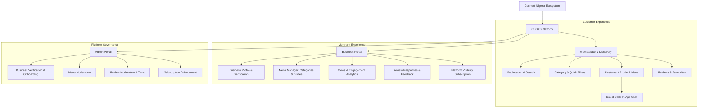

# Project Plan: CHOPS Discovery-First Rework

> **Project:** CHOPS (formerly CN Chop)  
> **Client / Organization:** Connect Nigeria  
> **Source Documents:**  
> - [Figma Design File: CN-Chop](https://www.figma.com/design/MaecyhoPyWrmrOFETANyUv/CN-Chop?node-id=0-1)  
> - [CHOPS Product Requirements Document (PRD)](https://docs.google.com/document/d/1CfNH-sDBIiPtJ0ktqsjxp6IQQZMcJFkduSgm_cJNjGI/edit)  
> - [Design System & Style Guide](file:///c:/Users/mbaek/Desktop/Chop.ng/design.md)  
> **Status:** Architecture & Planning Phase

---

## 1. Executive Summary & Strategic Pivot

### 1.1 Context & Strategic Direction
Shareholders and product leadership have directed a strategic rework of the **CN Chop** platform into **CHOPS**. The original iteration attempted to manage end-to-end food commerce—including in-app payments, cart checkout, multi-stage order tracking, dispatch algorithms, rider mobile apps, distance top-up pay calculations, and order dispute arbitration.

### 1.2 The Core Strategic Pivot
As detailed in the PRD update:
> *"Change note: CHOPS no longer supports in-app ordering, payment, or table booking. Restaurants list their menus and details on the platform; customers browse, discover, and view full restaurant/menu information, including table availability details, but all ordering, payment, and reservations now happen offline, directly between the customer and the restaurant (e.g. by phone call, chat, or in person). Every payment/checkout/online-order and booking element has been removed from this document and replaced with a discovery-and-contact flow."*

### 1.3 Key Architectural Value Proposition
1. **Friction-Free Customer Discovery:** Customers browse curated restaurant listings, dishes, rich photo galleries, transparent pricing, and table capacities without requiring payment details or complex checkout hurdles.
2. **Direct Contact Commerce:** High-converting **"Call Merchant"** and **"Chat to Order"** CTAs connect hungry diners directly with kitchens, fitting Nigerian dining behavior and eliminating payment gateway drop-offs.
3. **Streamlined Merchant Platform:** Restaurant managers gain tools to maintain digital menus, manage opening/closing hours, view profile impressions and customer engagement metrics, respond to reviews, and manage platform visibility subscriptions.
4. **Clean Operational Overhead:** Eliminates rider fleet management, split settlement calculations, payment refunds, and delivery dispute investigations from the platform operators.

---

## 2. System Architecture & Role Model

### 2.1 Role Flexibility Model
- **Unified Account Identity:** Users register with basic personal details (Name, Email, Phone, Password).
- **Dual Role Access:** Every approved merchant user can seamlessly toggle between **Customer Mode** (to discover other food spots) and **Business Mode** (to manage their kitchen listing).
- **Graceful Business Onboarding:** Customers can initiate merchant onboarding anytime; progress is autosaved so users can resume where they left off.

---

## 3. Scope Breakdown: Retained, Reworked, and Deprecated

| Module | Previous CN Chop (V1) | Reworked CHOPS (V2 Scope) | Implementation Action |
| :--- | :--- | :--- | :--- |
| **Landing & Discovery** | Search + Cart counter | Search, Geolocation, Categories, "Popular Near You", "Featured", "New on CHOPS" | **Enhance**: Add location autocomplete and filter chips |
| **Restaurant Profile** | Add-to-cart buttons | Rich Menu viewer, Variations, Photo gallery, About info, Table info | **Rework**: Replace cart actions with **Call** & **Chat** triggers |
| **Ordering & Payment** | In-app checkout, coupon engine, Paystack/card payment | **OFFLINE ONLY**: Customer connects with restaurant via Call or In-App Chat | **Deprecate**: Remove cart modal, checkout, and card gateways |
| **Table Booking** | In-app booking reservation flow & fee payment | **Informational Viewing**: Table capacities and booking contact instructions | **Rework**: Replace booking transaction flow with view-only table spec |
| **Delivery & Dispatch** | Automatic rider matching, distance fare calculation, rider job cards | **OFFLINE / DIRECT**: Delivery arranged between restaurant and customer | **Deprecate**: Remove rider app, rider wallet, and dispatch engine |
| **Disputes & Refunds** | 1-hour report window, dispute arbitration, bank refunds | Direct Customer Support & Merchant Reviews | **Deprecate**: Remove automated dispute arbitration subsystem |
| **Merchant Dashboard** | Order fulfillment pipeline (Accept, Prepare, Ready, Dispatch) | **Listing Operations**: Menu manager, Profile view analytics, Customer feedback | **Rework**: Pivot from order processing to discovery & menu management |
| **Monetization** | Transaction fees + delivery app fees | **Platform Visibility Subscriptions**: Monthly / Yearly listing fee | **Retain & Implement**: Visibility subscription management |

---

## 4. Phase-by-Phase Execution Roadmap

### Phase 1: Foundation & Design System Setup
- [x] Extract typography, color tokens, and spatial scale from Figma (`2558:209`, `2567:932`).
- [x] Create comprehensive `design.md` detailing token variables, components, and layout breakpoints.
- [ ] Implement `tokens.css` with CN Green (`#93C700`), CN Amber, and Slate palettes with full light/dark mode support.
- [ ] Establish foundational layout shell, responsive header, sticky navigation, and mobile drawer.

### Phase 2: Customer Discovery & Marketplace Experience
- [ ] **Hero Search & Geolocation Bar:**
  - Fast search input for dishes and restaurants.
  - Geolocation location selector with address suggestions.
- [ ] **Category & Quick Filter Bar:**
  - Food category horizontal scroll (Nigerian, Grills & Suya, Continental, Fast Food, Desserts).
  - Quick filters: `Open Now`, `Top Rated`, `Offers`, `Near Me`.
- [ ] **Curated Marketplace Sections:**
  - Featured Promoted Restaurants.
  - Popular Near You (ranked by distance and rating).
  - Trending Dishes (with dish photo, price, and instant inquiry button).
  - New on CHOPS (fresh listings).
- [ ] **Customer Favourites & Recent Views:** Local storage & account-synced saved spots.

### Phase 3: Restaurant Detail & Menu Experience
- [ ] **Restaurant Header Banner:**
  - High-res cover photo with dark radial gradient overlay.
  - Verified Merchant checkmark badge, cuisine tags, open/closed status indicator, opening hours.
  - Direct Action Bar: Primary **"Call Merchant"** (`tel:`) and Secondary **"Chat to Order"**.
- [ ] **Tabbed Restaurant Information Architecture:**
  - **Menu Tab:** Categorized dishes with photos, detailed descriptions, prices, portion variations, and add-on pricing. "Inquire/Order via Chat" action button per dish.
  - **Reviews & Ratings Tab:** Aggregated star breakdown, verified customer testimonials, and "Leave a Review" modal.
  - **Photo Gallery Tab:** Grid view of restaurant ambiance, seating, and food presentation.
  - **About & Contact Tab:** Full physical address, interactive map link, full operational hours by day, phone numbers, and social links.
  - **Table Availability Tab:** Informational view of table seating capacities, dining sections (Indoor / Terrace / VIP), and reservation phone contacts.

### Phase 4: Direct In-App Chat Module
- [ ] **Direct Customer ↔ Restaurant Messaging:**
  - Real-time conversation thread with message timestamping.
  - Pre-filled dish inquiry triggers (e.g. clicking "Inquire about Jollof Special" loads the dish name and price into the draft message).
  - Restaurant online/active indicator.
  - Quick action chips: *"Is this item available right now?"*, *"Can I arrange pickup in 30 minutes?"*.

### Phase 5: Business Portal & Menu Manager
- [ ] **Business Onboarding Flow:**
  - Step 1: Personal credentials.
  - Step 2: Business Profile (Name, Geolocation address selector, Contact numbers, Verification documents).
  - Step 3: Restaurant Setup (Cover photo, Bio, Tagline, Tags, Social Handles, Opening hours).
- [ ] **Merchant Control Center (Dashboard):**
  - **Performance KPIs:** Profile views, Menu impressions, Favourites count, Overall rating.
  - **Views Chart:** Weekly traffic analytics.
  - **Store Controls:** Instant "Open/Closed" toggle for real-time customer status.
- [ ] **Interactive Menu Manager:**
  - Category manager (create, edit, reorder, toggle availability).
  - Dish editor modal (Name, Description, Photo, Price, Availability toggle, Variations, Add-ons).
- [ ] **Reviews Management:** View customer feedback and post public merchant replies.
- [ ] **Platform Visibility Subscription:**
  - Plan overview (Monthly / Yearly visibility plans).
  - Expiration warnings (1-week notification) and billing status.

### Phase 6: Admin Governance & Moderation
- [ ] **Merchant Verification Queue:** Review submitted restaurant documents, approve or reject applications with feedback.
- [ ] **Menu & Content Moderation:** Audit listings and remove non-compliant items.
- [ ] **Review Moderation:** Flag abusive, spam, or defamatory reviews.
- [ ] **Subscription Enforcement:** Automatically manage marketplace visibility based on active subscription status.

### Phase 7: Quality Assurance, Testing & Delivery
- [ ] Cross-browser verification (Chrome, Safari, Edge, Firefox).
- [ ] Responsive device testing across Desktop (1440px), Laptop (1280px), Tablet (768px), and Mobile (390px/360px).
- [ ] Performance and accessibility audit (WCAG AA contrast ratios, keyboard navigability, fast initial render).
- [ ] Final handoff and stakeholder documentation.

---

## 5. Risk Assessment & Mitigations

| Risk | Impact | Mitigation Strategy |
| :--- | :--- | :--- |
| **Customer attempts to checkout online** | Confusion if expecting an in-app card payment | Clear UI messaging: *"Browse menu and connect directly with the restaurant to place and pay for your order."* Prominent Call & Chat buttons. |
| **Stale restaurant pricing or closed hours** | Poor customer trust | Prominent "Last Updated" timestamp on menus; Merchant Dashboard alerts to verify opening hours; active store status toggle. |
| **Unapproved or unverified kitchens** | Brand credibility risk | Mandatory admin approval flow before restaurant listing becomes visible on public marketplace. |
| **Expired subscription listings** | Revenue leakage | Automated cron/hook that sets restaurant visibility to hidden upon subscription lapse, with 7-day advance warnings. |
